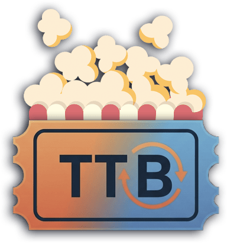

  

  <a href="https://jordanmrt.github.io/carnet-cine/">Accéder à Time To Binge</a>

# Time To Binge 🎟️

**Time To Binge** est une application web (installable comme une app sur ton téléphone) pour suivre ce que tu regardes : séries, films, épisodes vus, notes, statistiques… et revivre tes visionnages sous forme de tickets de cinéma.

Créée et développée en solo, en français, avec beaucoup de popcorn 🍿

## Ce que tu peux faire

- 🔍 **Rechercher** n'importe quel film ou série et l'ajouter à ta bibliothèque
- 📚 **Suivre ta progression** saison par saison, épisode par épisode, avec une coche rapide et une barre de progression
- 🎟️ **Tenir ton journal en tickets de cinéma** : un ticket par film vu et par série terminée, avec ta note et ton commentaire
- 📤 **Partager tes tickets** en image, au format feed ou story
- 🔁 **Compter tes revisionnages** (×2, ×3…) et les inclure dans tes statistiques
- 📊 **Consulter tes stats** : temps passé devant les séries et les films, note moyenne, genres favoris, activité des 12 derniers mois
- 🏅 **Débloquer des badges** en forme de billets, avec des paliers à poinçonner
- 🎨 **Changer d'ambiance** grâce à une quinzaine de thèmes, dont certains se débloquent avec les badges
- 🎁 **Retrouver ton année en revue** avec le Wrapped
- 📅 **Anticiper les sorties** avec le calendrier des films et épisodes à venir
- 👤 **Personnaliser ton profil** : avatar, bannière, pseudo et visibilité (public, abonnés ou privé)
- 🎃 **Profiter d'un écran de démarrage saisonnier**, qui change à Halloween et à Noël

## Installer l'application

Time To Binge s'utilise directement depuis le navigateur. Ouvre le lien ci-dessus, connecte-toi par lien magique (pas de mot de passe), ou ajoute-la à l'écran d'accueil de ton téléphone pour la retrouver comme une vraie app.

## Crédits

Les données et visuels des films et séries (affiches, synopsis, casting…) proviennent de [TMDB](https://www.themoviedb.org). *This product uses the TMDB API but is not endorsed or certified by TMDB.*

## Licence

© 2026 Jordan MRT. **Tous droits réservés.**

Le code source, le design, le logo, les icônes, les badges et les autres créations originales de ce dépôt sont protégés. Leur copie, modification, redistribution ou réutilisation, en tout ou partie, est interdite sans autorisation écrite préalable. Voir le fichier [LICENSE](./LICENSE) pour le détail.
